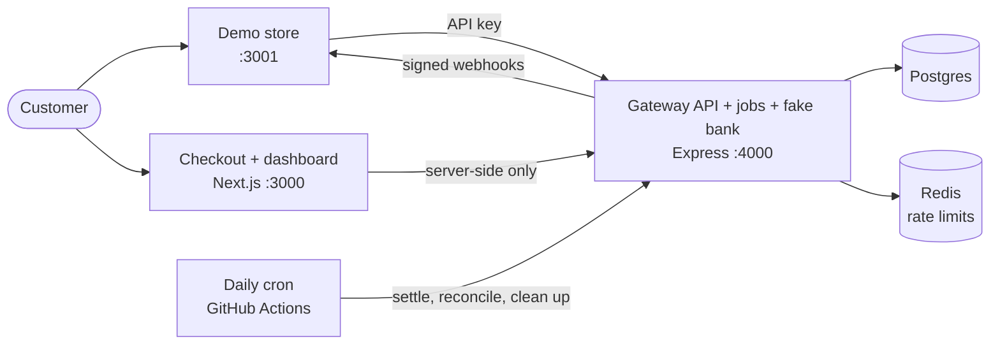
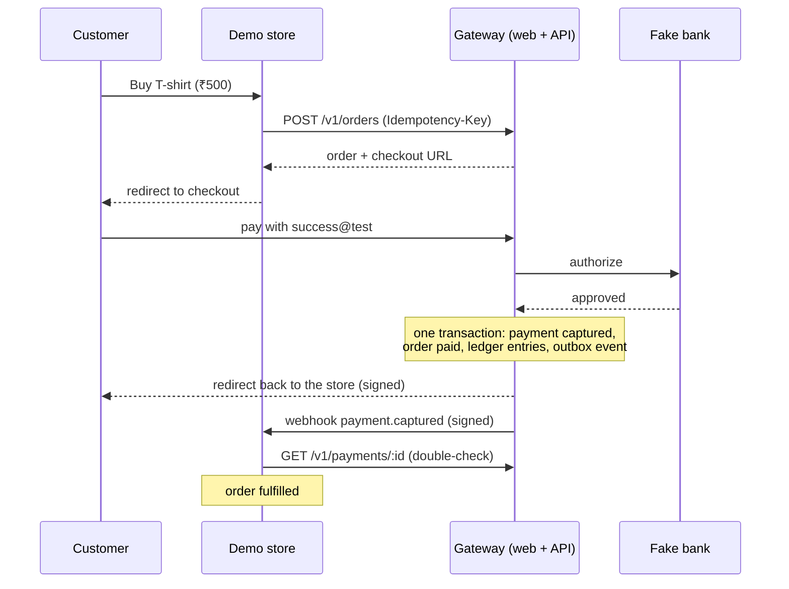

# Mini Payment Gateway

[](https://github.com/BUBAAcodes/mini-payment-gateway/actions/workflows/ci.yml)

**Live demo:** not deployed yet · **Demo login:** `demo@gateway.test` / `demo-password`

<!-- TODO: add a short GIF of buy → pay → "fulfilled" here, e.g.  -->

A small, test-mode payment gateway, in the spirit of Razorpay or Stripe, with a fake bank and no real money. A shop asks the gateway to create an order, the customer pays on the gateway's checkout page, and a simulated bank approves or declines. The gateway records every rupee in a double-entry ledger, tells the shop with signed webhooks, pays the shop its share once a day, and checks its records against the bank's. The point of the project is the hard part of payments: making sure money is never charged twice, never lost, and always adds up.

## What it does

- **Merchant API** (`/v1`) with API keys, idempotent `POST`s and per-key rate limiting
- **Hosted checkout** with simulated UPI and cards (with OTP), and a signed redirect back to the shop
- **Fake bank** that approves, declines, answers too slowly, or approves and never tells us
- **Payment state machine**, with only one attempt per order in progress at a time
- **Double-entry ledger**, append-only and checked by the database itself
- **Full and partial refunds** that can never add up to more than the payment
- **Signed webhooks** ([Standard Webhooks](https://www.standardwebhooks.com)) sent from an outbox, with retries for about 28 hours and replay
- **Daily settlement and reconciliation** against the bank's CSV file
- **Merchant dashboard**: payments, refunds, API keys, webhooks, events, settlements, reconciliation issues
- **Demo store** that integrates the way a real merchant should

## How it fits together



The browser never talks to the API directly: Next.js server code does. The webhook worker and the fake bank run inside the API process.

## One payment, start to finish



The store is owed ₹490 and the gateway keeps a ₹10 fee (2%). The next daily settlement pays out the ₹490.

[docs/architecture.md](docs/architecture.md) explains every part in detail: the layers, the ledger, the webhook worker, the background jobs, and where each rule is enforced.

## Tech stack

| Part                   | Tools                                                           |
| ---------------------- | --------------------------------------------------------------- |
| Language and repo      | TypeScript (strict), pnpm workspaces                            |
| API                    | Express 5, Zod, pino                                            |
| Database               | PostgreSQL 17, Prisma 7 (plus raw SQL for locks and triggers)   |
| Rate limiting          | Redis                                                           |
| Checkout and dashboard | Next.js (App Router), Tailwind, shadcn/ui, Better Auth          |
| API docs               | OpenAPI generated from Zod, shown with Scalar; Bruno collection |
| Tests                  | Vitest, Supertest, Testcontainers, Playwright, k6               |
| CI/CD and security     | GitHub Actions, GHCR, Trivy, CodeQL, Dependabot                 |

## Run it locally

You need **Docker**, **Node 24** and **pnpm 10** (`corepack enable` gives you the right pnpm).

**1. Install and create your `.env`**

```sh
pnpm install
cp .env.example .env
```

Fill in these four values in `.env`. Each one is a random secret:

| Variable                  | Generate with             |
| ------------------------- | ------------------------- |
| `APP_ENCRYPTION_KEY`      | `openssl rand -base64 32` |
| `INTERNAL_CRON_SECRET`    | `openssl rand -hex 32`    |
| `DASHBOARD_SERVICE_TOKEN` | `openssl rand -hex 32`    |
| `BETTER_AUTH_SECRET`      | `openssl rand -base64 32` |

**2. Start the database, then migrate and seed it**

```sh
docker compose up -d postgres redis
pnpm db:migrate
STORE_WEBHOOK_URL=http://demo-store:3001/webhooks/gateway pnpm db:seed
```

The seed creates a demo merchant, a dashboard login, an API key, a webhook endpoint for the demo store and a few sample payments. It prints three `GATEWAY_*` secrets **once**. Copy those three lines into `.env`. (`STORE_WEBHOOK_URL` is needed because, inside Docker, the API reaches the store by its service name, not `localhost`.)

**3. Start everything**

```sh
docker compose up --build
```

| Open                                                        | What                                                          |
| ----------------------------------------------------------- | ------------------------------------------------------------- |
| [localhost:3001](http://localhost:3001)                     | Demo store: start here                                        |
| [localhost:3000/dashboard](http://localhost:3000/dashboard) | Dashboard (log in with `demo@gateway.test` / `demo-password`) |
| [localhost:4000/docs](http://localhost:4000/docs)           | API reference                                                 |

**4. Make a payment.** On the store click **Buy now**, pay with UPI `success@test`, and watch the order flip to **Fulfilled** a few seconds later, when the webhook arrives. Then find the payment in the dashboard and try a refund.

To start over with an empty database: `pnpm db:reset` (deletes all data), then seed again.

### Test inputs

Checkout lists these too. Nothing else works: there is no real money anywhere.

| Input                                          | What the fake bank does                                                     |
| ---------------------------------------------- | --------------------------------------------------------------------------- |
| UPI `success@test`                             | Approves in about a second                                                  |
| UPI `fail@test`                                | Declines (`insufficient_funds`). You can try again on the same order        |
| UPI `slow@test`                                | Answers after 20 s. We stop waiting at 10 s, and a status check finishes it |
| UPI `lost@test`                                | Approves but never tells us. Next day's reconciliation flags it             |
| Card `4111 1111 1111 1111`                     | Approves after OTP `123456` (any future expiry, any name)                   |
| Card ending `0002`, e.g. `4000 0000 0000 0002` | Declines (`card_declined`)                                                  |

## Tests

```sh
pnpm test          # unit + integration tests (needs Docker: Testcontainers starts Postgres and Redis)
pnpm test:e2e      # Playwright: builds and starts the whole stack in Docker
pnpm test:load     # k6 idempotency load test, local Docker only
pnpm typecheck && pnpm lint && pnpm format:check
```

Stop `docker compose` first for `test:e2e` and `test:load`: they start their own stack on the same ports.

- **613 Vitest tests** across the five packages, plus **3 Playwright** journeys (UPI success, card with OTP, a declined payment then a successful retry).
- Integration tests run against real Postgres, and cover the concurrency cases: 20 parallel requests with one idempotency key make one order, ten simultaneous refunds never over-refund, two webhook senders never send the same delivery twice, and a capture that fails half-way leaves nothing behind.
- **Load test:** 200 concurrent `POST /v1/orders` with one idempotency key created exactly **1 order** (199 replays), p95 latency **934 ms**, on local Docker.

CI runs all of it on every pull request, builds and scans the Docker images, and on main pushes them to GHCR.

## API docs

- **Scalar reference** at `/docs` on the API ([localhost:4000/docs](http://localhost:4000/docs)), generated from the same Zod schemas that validate requests.
- **Bruno collection** in [docs/bruno/](docs/bruno/). Open the folder in [Bruno](https://www.usebruno.com), pick the `local` environment and paste in the API key the seed printed.

## Design decisions

The main choices, in short. Longer write-ups with the trade-offs are in [docs/decisions/](docs/decisions/).

- **Money is integer paise.** Floats can't represent ₹0.10 exactly; integers can.
- **Idempotency keys are claimed before the work starts.** The first request inserts the key; Postgres makes racing inserts take turns, so only one request ever does the work. The rest get the saved response.
- **A ledger, not a balance column.** Every movement is a balanced pair of entries that is never edited. Balances are computed from it, and the database refuses any unbalanced or edited entry.
- **Webhooks go through an outbox.** The event is saved in the same transaction as the payment. A crash can't lose it, and a worker sends it later, with retries.
- **No database transaction stays open during a network call.** Rows are locked, changed and committed; then the bank or webhook is called.
- **A bank timeout means "unknown", not "failed".** The payment stays pending until a status check gets a real answer.
- **The fee is not returned on refunds** ([0001](docs/decisions/0001-fee-not-refunded.md)).
- **Settlements stamp the rows they pay**, so nothing is missed or paid twice ([0002](docs/decisions/0002-settlement-marks-rows.md)).
- **The rate limiter fails open** if Redis is down: it protects the server, not the money ([0003](docs/decisions/0003-rate-limiter-fails-open.md)).
- **The dashboard calls the API with a service token** and the logged-in merchant's ID ([0004](docs/decisions/0004-dashboard-service-token.md)).
- **"Today" on the dashboard is the Indian day** ([0005](docs/decisions/0005-dashboard-today-is-ist.md)).

## Limitations

This is a learning project in test mode. A real gateway does much more:

| Area               | Real gateway                                            | This project                                    |
| ------------------ | ------------------------------------------------------- | ----------------------------------------------- |
| Moving money       | Banks, UPI through NPCI, card networks                  | One fake bank inside the API                    |
| Licence and rules  | RBI authorisation, merchant KYC, escrow accounts        | Test mode only                                  |
| Cards              | Tokenisation, PCI DSS audits, OTP from the issuing bank | Fake cards and OTP; only the last 4 digits kept |
| Settlement         | Real bank transfers on a cycle (e.g. T+2)               | Ledger payouts with a configurable delay        |
| Fraud and disputes | Risk scoring, chargebacks                               | None                                            |
| Payment methods    | UPI, cards, netbanking, wallets, EMI, pay later         | Simulated UPI and cards, INR only               |
| Scale              | Many services and data centres                          | One API and one database, on free tiers         |

Also:

- The demo store keeps its orders and seen webhook IDs **in memory**, so a restart forgets them. A real merchant would use its database.
- The rate limit is a fixed window per minute, so a client can burst at the edge of a window.
- Webhook endpoints that keep failing are not disabled automatically.
- On free hosting the server sleeps when idle; background jobs catch up when it wakes.

## Project layout

```text
apps/
  api/          Express API, background jobs, fake bank
  web/          Next.js: checkout (/pay/[orderId]) and dashboard
  demo-store/   A pretend merchant
packages/
  shared/       Zod schemas, money, IDs, errors, signing and encryption helpers
  db/           Prisma schema, migrations, seed, client
e2e/            Playwright tests
load/           k6 load test
docs/           Architecture, design decisions, Bruno collection
```

## How it was built

Designed by me, built step by step with [Claude Code](https://claude.com/claude-code), and reviewed and tested by me: each step began with a plan I approved, then tests, then code.
