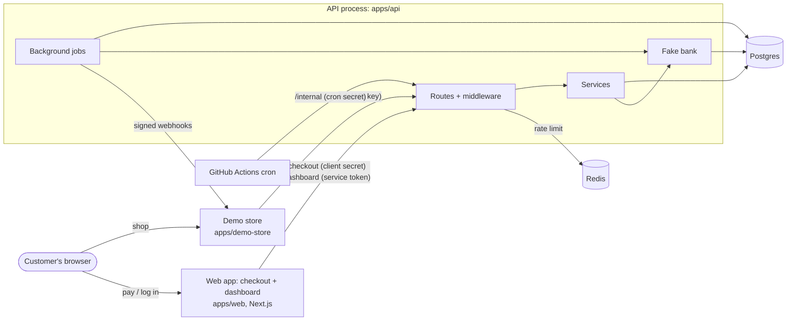
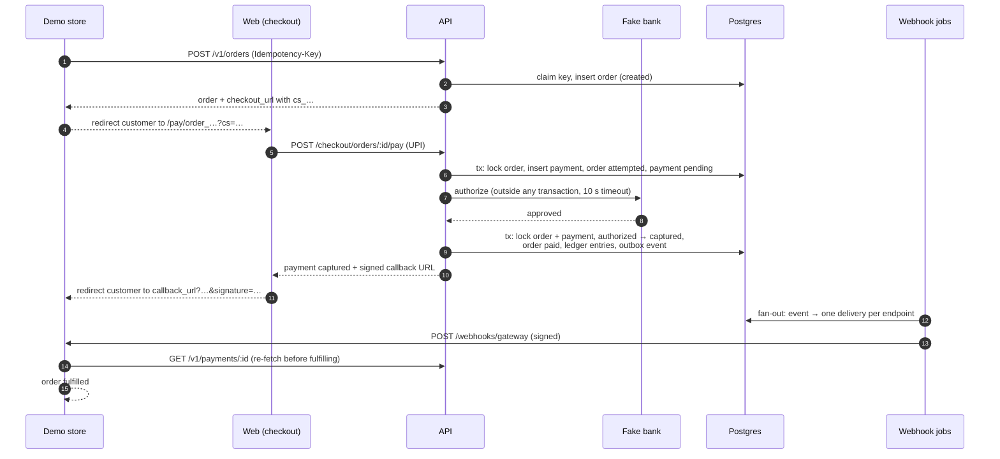
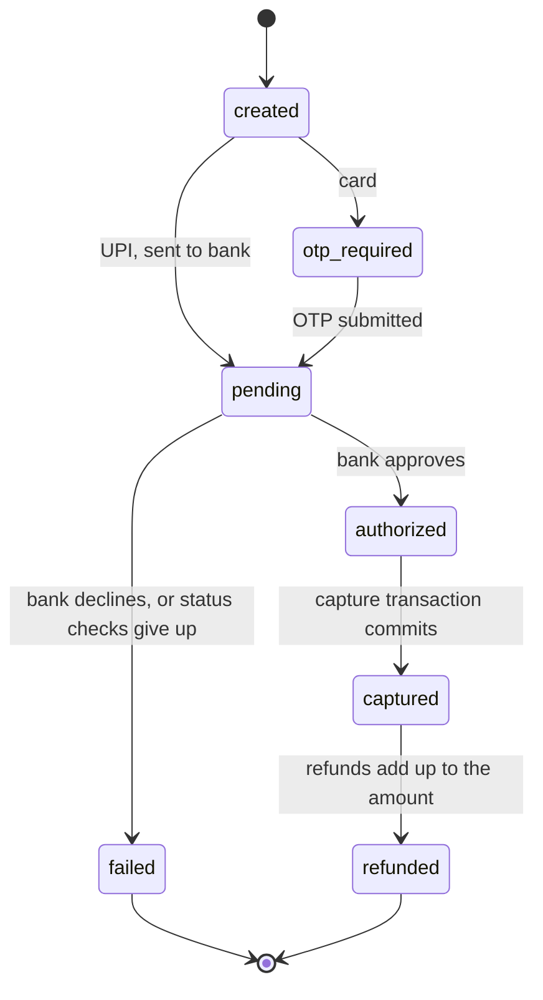
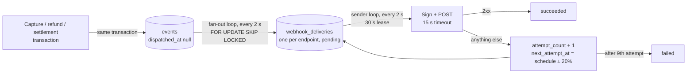

# Architecture

How the gateway is put together, why it is built that way, and where to look in the code. The [README](../README.md) covers what the project is and how to run it. Design decisions with their trade-offs are in [`decisions/`](decisions/).

## Contents

1. [The big picture](#1-the-big-picture)
2. [The pieces](#2-the-pieces)
3. [Who may call what](#3-who-may-call-what)
4. [A payment, step by step](#4-a-payment-step-by-step)
5. [The ledger](#5-the-ledger)
6. [Refunds](#6-refunds)
7. [Webhooks: outbox, fan-out, sender](#7-webhooks-outbox-fan-out-sender)
8. [Background jobs](#8-background-jobs)
9. [Daily jobs: settlement, reconciliation, cleanup](#9-daily-jobs-settlement-reconciliation-cleanup)
10. [Where each rule is enforced](#10-where-each-rule-is-enforced)
11. [What happens when things go wrong](#11-what-happens-when-things-go-wrong)
12. [Data model](#12-data-model)
13. [Security](#13-security)
14. [Tests](#14-tests)
15. [Build, CI and deployment](#15-build-ci-and-deployment)

---

## 1. The big picture

Three apps and two data stores. Postgres is the only source of truth; Redis only counts requests for the rate limiter.

Things to notice:

- **The browser never calls the API.** Checkout and dashboard pages are rendered by Next.js server code, which calls the API. So the API needs no CORS, and secrets like the dashboard service token never reach a browser.
- **The worker lives inside the API process.** The free host has no background workers, so `server.ts` starts the HTTP server and the job loops side by side ([`apps/api/src/server.ts`](../apps/api/src/server.ts)).
- **The fake bank also lives inside the API**, behind a `BankClient` interface, but keeps its own table (`bank_transactions`). That gives reconciliation two independent records to compare.

## 2. The pieces

### `apps/api`: the gateway

Express 5. A request goes through these layers, top to bottom:

| Layer      | Folder                                       | What it does                                                                                                                                                       |
| ---------- | -------------------------------------------- | ------------------------------------------------------------------------------------------------------------------------------------------------------------------ |
| App setup  | [`app.ts`](../apps/api/src/app.ts)           | helmet, pino request logging with a request ID, 100 KB JSON limit, mounts the routers, 404 and error handlers                                                      |
| Routes     | [`routes/`](../apps/api/src/routes/)         | Four routers, one per kind of caller: `merchant` (`/v1`), `checkout`, `dashboard`, `internal`. Plus `/health`, `/ready` and `/docs`                                |
| Middleware | [`middleware/`](../apps/api/src/middleware/) | `auth` (API key, service token, cron secret), `rate-limit`, `validate` (Zod), `idempotency`, `request-id`, `errors`                                                |
| Services   | [`services/`](../apps/api/src/services/)     | The business logic, one file per area: orders, checkout, payments, payment-state, ledger, refunds, events, webhooks, settlements, reconciliation. Routes stay thin |
| Jobs       | [`jobs/`](../apps/api/src/jobs/)             | Loops started by `server.ts`: webhook fan-out, webhook sender, payment and refund status checks. `runner.ts` runs each one at startup and then on an interval      |
| Fake bank  | [`fake-bank/`](../apps/api/src/fake-bank/)   | `BankClient` (authorize, getStatus, refund, settlementFile). `scenarios.ts` maps test inputs (`success@test`, card `…1111`) to outcomes                            |
| OpenAPI    | [`openapi/`](../apps/api/src/openapi/)       | Builds the OpenAPI document from the same Zod schemas the routes validate with; Scalar serves it at `/docs`                                                        |

Dependencies (database, bank, config, Redis store) are passed into `createApp()`, not imported. That is what lets tests run the real app against a test database, a fake clock and an in-memory rate-limit store.

### `apps/web`: checkout and dashboard

Next.js App Router, Tailwind and shadcn/ui.

- **Checkout** is `/pay/[orderId]?cs=…`. Server actions call `/checkout/*` with the order's client secret. The page shows UPI and card forms, an OTP screen, then polls until the payment is final and redirects the customer to the merchant's `callback_url`.
- **Dashboard** is `/dashboard/*`: overview, payments (with refund), API keys, webhooks, events (with replay), settlements and reconciliation. Login is Better Auth (email and password); its tables live in the same Postgres.
- **All API calls go through one function**, `callApi()` in [`lib/api-client.ts`](../apps/web/src/lib/api-client.ts), which is `server-only`, so importing it from browser code fails the build.
- **Route protection is two layers.** [`proxy.ts`](../apps/web/src/proxy.ts) redirects visitors with no session cookie to `/login` (fast, no database). [`requireMerchant()`](../apps/web/src/lib/session.ts) checks the session is real on every page and action, and is the only place the merchant ID comes from.

### `apps/demo-store`: a pretend merchant

A small Express app selling one T-shirt. It does what a real merchant integration should: creates orders with an `Idempotency-Key`, checks the checkout redirect signature, verifies webhook signatures on the raw body, skips webhook IDs it has seen, and re-fetches the payment before fulfilling. It keeps orders in memory. See [its README](../apps/demo-store/README.md).

### `packages/shared`

Code more than one app needs, with no database access: Zod schemas and response types, money and fee helpers, prefixed IDs, error classes, AES-256-GCM encryption, API key and secret helpers, Standard Webhooks signing and verifying, the checkout redirect signature, Luhn and card network, and India-time day bounds.

### `packages/db`

The Prisma 7 schema, migrations (some with hand-written SQL for checks, the partial unique index and the ledger triggers), the one Prisma client every app imports, the seed script, and Testcontainers setup for integration tests.

## 3. Who may call what

Each kind of caller has its own router and its own credential.

| Caller                    | Routes                       | Proves who it is with                                                     | Checked in                                      |
| ------------------------- | ---------------------------- | ------------------------------------------------------------------------- | ----------------------------------------------- |
| Merchant's server         | `/v1/*`                      | `Authorization: Bearer sk_test_…` (rate limited per key)                  | `requireApiKey`, `rateLimitPerApiKey`           |
| Checkout page (Next.js)   | `/checkout/*`                | The order's client secret `cs_…`, from the checkout URL                   | `hasClientSecret()` in `services/checkout.ts`   |
| Dashboard (Next.js)       | `/dashboard/*`               | `DASHBOARD_SERVICE_TOKEN` plus `X-Merchant-Id` from the logged-in session | `requireDashboardService` ([decision 0004][d4]) |
| Daily cron                | `/internal/*`                | `INTERNAL_CRON_SECRET`                                                    | `requireBearerSecret`                           |
| Anyone                    | `/health`, `/ready`, `/docs` | Nothing                                                                   | -                                               |
| The gateway, to merchants | Merchant's webhook URL       | Standard Webhooks signature with the endpoint's `whsec_` secret           | The receiver (the demo store's `webhooks.ts`)   |

Both the merchant API and the dashboard end up setting `res.locals.merchantId`, and the dashboard router mounts the merchant API's own routers. So every merchant-scoped query is the same code whichever way you arrive, and every one filters by `merchant_id`. Another merchant's object is always a 404, never a 403, so IDs can't be probed.

## 4. A payment, step by step

The code path: `routes/checkout` → `startPayment()` ([`services/checkout.ts`](../apps/api/src/services/checkout.ts)) → `authorizeWithBank()` → `applyBankAnswer()` → `capturePayment()` ([`services/payments.ts`](../apps/api/src/services/payments.ts)).

**Card payments** stop at `otp_required` after the first transaction. `POST /checkout/payments/:id/otp` moves the payment to `pending` and sends the OTP and the last four digits to the bank. The full card number never gets past `createAttempt()`.

### Payment states

All moves go through `moveTo()` in [`services/payment-state.ts`](../apps/api/src/services/payment-state.ts). It checks the move against the `ALLOWED_MOVES` table, and its `UPDATE … WHERE status = <the status we read>` turns a lost race into an `invalid_state` error instead of a silent overwrite. In practice `authorized` lasts only inside the capture transaction: payments are captured automatically.

Orders move `created → attempted → paid`. A failed attempt leaves the order `attempted`, and the customer can try again, which creates a new payment.

### Two attempts at once

The pay transaction locks the order row (`SELECT … FOR UPDATE`) and then inserts the payment. A partial unique index, `one_active_attempt`, allows at most one payment per order in `created`, `otp_required`, `pending` or `authorized`. A second attempt while one is in progress gets a 409.

Every transaction that locks both an order and its payment takes the order first. Taking them in the opposite order in different places is how deadlocks happen.

## 5. The ledger

Double-entry, append-only, in three tables: `ledger_accounts`, `ledger_transactions`, `ledger_entries`.

| Event                  | Debit                          | Credit                                              |
| ---------------------- | ------------------------------ | --------------------------------------------------- |
| Capture ₹500, ₹10 fee  | `gateway_clearing` 50,000      | `merchant_balance:{id}` 49,000, `fee_revenue` 1,000 |
| Refund ₹200            | `merchant_balance:{id}` 20,000 | `gateway_clearing` 20,000                           |
| Settlement payout ₹290 | `merchant_balance:{id}` 29,000 | `payouts` 29,000                                    |

A merchant's balance is credits minus debits on its `merchant_balance` account. There is no balance column to drift out of sync.

The rules are enforced twice:

1. **In code**, `postLedgerTransaction()` in [`services/ledger.ts`](../apps/api/src/services/ledger.ts) refuses unbalanced or non-positive entries before writing, with a clear error.
2. **In the database**, as a backstop no code can skip:
   - a deferrable constraint trigger checks at `COMMIT` that each transaction's debits equal its credits;
   - triggers reject `UPDATE`, `DELETE` and `TRUNCATE` on ledger rows;
   - `CHECK (amount > 0)` on entries.

The fee is not given back on refunds ([decision 0001][d1]), so a fully refunded payment leaves the merchant's balance at −fee. Negative balances are allowed and recovered from later settlements.

## 6. Refunds

[`services/refunds.ts`](../apps/api/src/services/refunds.ts), in three steps so that no transaction is open during the bank call:

1. **Reserve**, in one transaction: lock the payment, check it is `captured` and that the amount fits in what is left, create the refund (`pending`) and raise `amount_refunded` straight away. Two refunds on one payment take turns on the lock, and the first one's amount is already counted when the second one checks. A `CHECK (amount_refunded BETWEEN 0 AND amount)` backs this up.
2. **Ask the bank**, outside any transaction.
3. **Apply the answer**, in one transaction: processed → ledger refund entries, payment `refunded` if fully refunded, event `refund.processed`. Failed → lower `amount_refunded` again, event `refund.failed`.

If the bank doesn't answer in time, the refund stays `pending` and the refund status-check job finishes it. The bank keys refunds on our `rfnd_` ID, so asking again never refunds twice.

## 7. Webhooks: outbox, fan-out, sender

Webhooks are never sent from inside a request. The change and its event are written in the **same transaction**, into the `events` table (the outbox). If the transaction commits, the event exists; if it rolls back, so does the event. A crash between "payment captured" and "webhook sent" can't lose the webhook, because the event is already in the database.

- **Fan-out** ([`jobs/webhook-fan-out.ts`](../apps/api/src/jobs/webhook-fan-out.ts)): claims undispatched events with `FOR UPDATE SKIP LOCKED`, creates one delivery per enabled endpoint subscribed to that event type, and marks the events dispatched, all in one transaction.
- **Sender** ([`jobs/webhook-sender.ts`](../apps/api/src/jobs/webhook-sender.ts)): one `UPDATE … WHERE id IN (SELECT … FOR UPDATE SKIP LOCKED) RETURNING` sets a 30-second lease (`locked_until`) and commits at once. The HTTP calls happen after that, outside any transaction, in parallel, so a batch of 10 finishes within one 15-second timeout, well inside the lease.
- **At least once.** If a sender dies mid-send, its lease expires and another sender picks the delivery up. The receiver may get the same webhook twice, which is why receivers skip IDs they have seen.
- **Retry schedule:** immediately, 5 s, 5 min, 30 min, 2 h, 5 h, 10 h, 10 h, each ±20% jitter. That is up to 9 attempts over about 28 hours, then `failed`. Redirects count as failures.
- **Replay** (`POST /v1/events/:id/redeliver`) creates a fresh pending delivery for the same event, with the same `webhook-id`.
- **Signing** follows [Standard Webhooks](https://www.standardwebhooks.com): HMAC-SHA256 over `{id}.{timestamp}.{raw body}`, sent as `webhook-signature: v1,<base64>` ([`packages/shared/src/webhook-signature.ts`](../packages/shared/src/webhook-signature.ts)).
- **SSRF protection** ([`services/ssrf.ts`](../apps/api/src/services/ssrf.ts)): only `http`/`https`, and private, loopback and link-local addresses are refused, both when the URL is saved and again at send time through a guarded DNS lookup, because DNS can change. `ALLOW_PRIVATE_WEBHOOK_URLS=true` turns this off for local Docker, where the store is at `http://demo-store:3001`.

## 8. Background jobs

All started by `server.ts` through `startJob()` ([`jobs/runner.ts`](../apps/api/src/jobs/runner.ts)), which runs each job **once at startup** (to catch up on work that fell due while the free server slept) and then again a fixed interval after each run ends, so runs never overlap. A failed run is logged and the next one goes ahead.

| Job                     | Every | What it does                                                                                                                                        |
| ----------------------- | ----- | --------------------------------------------------------------------------------------------------------------------------------------------------- |
| `webhook-fan-out`       | 2 s   | Events → deliveries (section 7)                                                                                                                     |
| `webhook-sender`        | 2 s   | Sends due deliveries, schedules retries                                                                                                             |
| `payment-status-checks` | 30 s  | Asks the bank about `pending` payments; applies a final answer through the normal capture/fail code. After 15 minutes: `failed` with `bank_timeout` |
| `refund-status-checks`  | 30 s  | The same for `pending` refunds, resending the refund if the bank never received it                                                                  |

Every job claims its rows with `FOR UPDATE SKIP LOCKED` in a statement that commits immediately, then does slow work (HTTP, bank calls) with no transaction open. Several API instances could run the same jobs safely; they would just split the work.

## 9. Daily jobs: settlement, reconciliation, cleanup

[`.github/workflows/cron.yml`](../.github/workflows/cron.yml) runs at 02:00 IST and calls three `/internal` routes with `curl --retry`, since the free server takes about a minute to wake. Each route is safe to call again.

- **`POST /internal/settle`** ([`services/settlements.ts`](../apps/api/src/services/settlements.ts)): for each merchant, in one transaction, locks the merchant, takes every captured payment and processed refund that has no `settlement_id` yet and is older than `SETTLEMENT_DELAY_DAYS`, and, if the net is positive, writes the settlement, stamps those rows with its ID, posts the payout to the ledger and records `settlement.processed`. Stamping rows instead of using a time window means a capture that commits late is never missed, and no row is ever paid twice ([decision 0002][d2]).
- **`POST /internal/reconcile`** ([`services/reconciliation.ts`](../apps/api/src/services/reconciliation.ts)): imports the fake bank's CSV for a day and compares it, row by row, with our payments and refunds. Differences become `reconciliation_issues`: `missing_in_gateway`, `missing_in_bank`, `amount_mismatch` or `status_mismatch`. With no date given, it catches up every day since the last import, up to 7. It never changes a payment; a person resolves issues from the dashboard. This is how a `lost@test` payment (the bank approved, we gave up) gets caught.
- **`POST /internal/cleanup`**: deletes idempotency keys older than 24 hours.

## 10. Where each rule is enforced

The project's rules, where the code enforces them, and the test that proves it.

| Rule                                                 | Enforced by                                                                                                    | Proved by                                                                |
| ---------------------------------------------------- | -------------------------------------------------------------------------------------------------------------- | ------------------------------------------------------------------------ |
| Money is integer paise, ₹1 to ₹5,00,000              | Zod schemas; `CHECK` constraints; integer fee math (`calculateFee`)                                            | `packages/shared/src/fee.test.ts`, `money.test.ts`                       |
| Same `Idempotency-Key` never creates twice           | `idempotent()`: insert the key row first (`ON CONFLICT DO NOTHING`); the primary key serializes racing inserts | `apps/api/test/idempotency.test.ts` (20 in parallel), k6 load test       |
| Every ledger transaction balances; rows never change | `checkBalanced()`; deferrable constraint trigger; append-only triggers                                         | `packages/db/test/ledger-guards.test.ts`, `apps/api/test/ledger.test.ts` |
| State change + ledger + event commit together        | One `db.$transaction` around all three                                                                         | `apps/api/test/capture-rollback.test.ts`                                 |
| One payment per order, one attempt at a time         | Order row lock; `one_active_attempt` partial unique index; `markOrderPaid` only from `attempted`               | `apps/api/test/checkout.test.ts`                                         |
| No over-refunds                                      | Payment row lock; `amount_refunded` reserved up front; `CHECK (amount_refunded BETWEEN 0 AND amount)`          | `apps/api/test/refunds.test.ts`                                          |
| Webhooks signed, at least once                       | Standard Webhooks signing; outbox; leases with `SKIP LOCKED`; retry schedule                                   | `apps/api/test/webhook-worker.test.ts`, `webhook-signature.test.ts`      |
| Keys hashed, other secrets encrypted                 | SHA-256 + prefix for API keys; AES-256-GCM for webhook, checkout secrets and stored idempotent responses       | `apps/api/test/api-keys.test.ts`, `packages/shared/src/crypto.test.ts`   |
| No full card numbers stored or logged                | `createAttempt()` keeps only last four and network; pino `redact`                                              | `apps/api/test/checkout.test.ts`                                         |
| A bank timeout is "unknown", not "failed"            | `authorizeWithBank()` leaves the payment `pending`; status-check job resolves it                               | `apps/api/test/payment-status-checks.test.ts`                            |
| No transaction open during network calls             | Claim-then-commit everywhere; bank and webhook calls only after commit                                         | Code review; the job tests                                               |
| Jobs catch up after sleeping                         | `startJob()` runs at startup; loops drain until a batch comes back short                                       | `apps/api/src/jobs/runner.test.ts`                                       |
| A merchant sees only its own data                    | Every query filters by `merchant_id`; 404 for anyone else's                                                    | `apps/api/test/auth.test.ts`, `dashboard.test.ts`                        |

## 11. What happens when things go wrong

| Situation                                          | What happens                                                                                                                                        |
| -------------------------------------------------- | --------------------------------------------------------------------------------------------------------------------------------------------------- |
| Merchant retries `POST /v1/orders` after a timeout | Same key: the stored response comes back with `Idempotent-Replayed: true`. Still running: 409. Different body: 422                                  |
| Bank takes longer than 10 s                        | Payment stays `pending`. The status-check job asks the bank every 30 s and captures or fails it. After 15 minutes it fails with `bank_timeout`      |
| Bank approved but never told us (`lost@test`)      | Status checks give up → `failed`. Next day, reconciliation finds the bank's "success" row → `status_mismatch` issue on the dashboard                |
| Server crashes right after capture                 | The capture and its event committed together, so the fan-out loop finds the event on restart and the webhook goes out                               |
| Server crashes during the capture transaction      | Nothing committed. The payment is still `pending`, and the next status check captures it exactly once                                               |
| Webhook sender dies mid-send                       | The 30 s lease runs out; another run sends the delivery again. The receiver may see it twice and skips the duplicate                                |
| Merchant's webhook endpoint is down                | Retries on the schedule for about 28 hours, then `failed`. The merchant can replay it from the dashboard or the API                                 |
| Redis is down                                      | The rate limiter fails open: requests go through uncounted and a warning is logged ([decision 0003][d3]). Money correctness never depended on Redis |
| The free server was asleep                         | Every job runs once at startup and drains its backlog; the cron retries while the server wakes up                                                   |

## 12. Data model

All money is `Int` paise. Every merchant-owned table has `merchant_id`. Schema: [`packages/db/prisma/schema.prisma`](../packages/db/prisma/schema.prisma).

| Table                                                      | Why it exists                                                                                              |
| ---------------------------------------------------------- | ---------------------------------------------------------------------------------------------------------- |
| `merchants`                                                | The shops. Holds the encrypted checkout signing secret                                                     |
| `users`, `session`, `account`, `verification`              | Better Auth dashboard logins; `users.merchant_id` links a login to its merchant                            |
| `api_keys`                                                 | Merchant API keys, stored as a lookup prefix plus a SHA-256 hash                                           |
| `orders`                                                   | What the merchant wants to be paid for, with the hashed client secret and the callback URL                 |
| `payments`                                                 | Each attempt to pay an order, with its state, fee, refunded amount and bank reference                      |
| `refunds`                                                  | Money returned on a captured payment                                                                       |
| `ledger_accounts`, `ledger_transactions`, `ledger_entries` | The double-entry record of who owes whom                                                                   |
| `idempotency_keys`                                         | Remembers each `Idempotency-Key` and its (encrypted) response for 24 hours                                 |
| `events`                                                   | The outbox: one row per thing that happened, written in the same transaction as the change                 |
| `webhook_endpoints`                                        | Where each merchant wants webhooks, which event types, and the encrypted signing secret                    |
| `webhook_deliveries`                                       | One row per event per endpoint: status, attempts, lease, last response                                     |
| `settlements`                                              | Each payout to a merchant: gross, fees, refunds, net. Payments and refunds point back with `settlement_id` |
| `bank_settlement_files`, `bank_settlement_rows`            | The bank's daily CSV as imported, kept for audit                                                           |
| `reconciliation_issues`                                    | Every disagreement between us and the bank, until someone marks it resolved                                |
| `bank_transactions`                                        | The fake bank's own records, deliberately separate from ours                                               |

## 13. Security

- **API keys** (`sk_test_…`) are shown once. We store the first 12 characters to find the row and a SHA-256 hash to check it, compared in constant time. Revocable; `last_used_at` is recorded.
- **Secrets we must use again** (webhook signing secrets, checkout signing secrets) can't be hashed, so they are encrypted with AES-256-GCM under `APP_ENCRYPTION_KEY`. Stored idempotent responses are encrypted too, because the order response contains the client secret.
- **Every input** is validated with Zod; JSON bodies are capped at 100 KB; helmet sets security headers.
- **Logs** redact the `authorization` and `cookie` headers, card fields, OTPs, secrets and the `?cs=` client secret. Request bodies are not logged. Every line carries the request ID.
- **Checkout redirects** carry `signature = HMAC_SHA256("{order_id}|{payment_id}", checkout secret)`, so the store can tell a real redirect from a forged one. The `status` field isn't signed, so the store re-fetches the payment before trusting it.
- **CI** runs CodeQL, Trivy on every image, and Dependabot for npm and GitHub Actions. Third-party actions are pinned to commit SHAs.

## 14. Tests

| Kind        | Where                                 | Runs against                                                                           |
| ----------- | ------------------------------------- | -------------------------------------------------------------------------------------- |
| Unit        | `*.test.ts` next to the code (`src/`) | Nothing external: fee math, state machine, signatures, retry schedule, Luhn, AES-GCM   |
| Integration | `apps/api/test/`, `packages/db/test/` | Real Postgres and Redis started by Testcontainers. The whole Express app via Supertest |
| End to end  | `e2e/tests/`                          | The full Docker stack, driven by Playwright: store → checkout → fulfilled → dashboard  |
| Load        | `load/` (k6)                          | Local Docker only: 200 concurrent requests with one `Idempotency-Key`                  |

Tests that involve time (retries, 15-minute give-up, settlement delay) pass their own clock, so nothing sleeps.

## 15. Build, CI and deployment

- **Images:** one multi-stage Dockerfile per app (`api`, `web`, `demo-store`), built from the repo root, running as a non-root user with a `HEALTHCHECK`.
- **CI** ([`.github/workflows/ci.yml`](../.github/workflows/ci.yml)) on every pull request and push to main: format check, lint, typecheck, unit and integration tests with coverage; Playwright against the Docker stack; build and Trivy-scan every image.
- **On merge to main**, once those pass: push images to GHCR tagged with the commit SHA, and run `prisma migrate deploy` against the production database. Migrations run from CI because Render's free tier has no pre-deploy step, so they must stay backward compatible.
- **Where it runs (free tiers):**

  | Piece         | Service | Deploys how                                                                      |
  | ------------- | ------- | -------------------------------------------------------------------------------- |
  | API + jobs    | Render  | From main, once this commit's CI checks pass                                     |
  | Demo store    | Render  | Same as the API                                                                  |
  | Web           | Vercel  | From Git (root directory `apps/web`), with a preview deployment on every PR      |
  | Postgres      | Neon    | Schema changes only through the CI `migrate` job, using its direct URL           |
  | Redis         | Upstash | Nothing to deploy: it only holds rate-limit counters                             |
  | Docker images | GHCR    | Public `ghcr.io/bubaacodes/gateway-{api,web,demo-store}`, tagged with the commit |

- **GitHub settings the workflows need:** the secret `DIRECT_DATABASE_URL` (Neon's direct URL, for `migrate`), the variable `API_BASE_URL` and the secret `INTERNAL_CRON_SECRET` (for the daily [cron](../.github/workflows/cron.yml)). Without them, those jobs skip instead of failing.
- **Branch protection on main:** the five CI checks (format/lint/typecheck/test, Playwright, and the three image builds) must pass before a merge.
- **Sleep:** Render's free server sleeps after about 15 idle minutes. The cron retries while it wakes, and every background job catches up on overdue work at startup.

[d1]: decisions/0001-fee-not-refunded.md
[d2]: decisions/0002-settlement-marks-rows.md
[d3]: decisions/0003-rate-limiter-fails-open.md
[d4]: decisions/0004-dashboard-service-token.md
